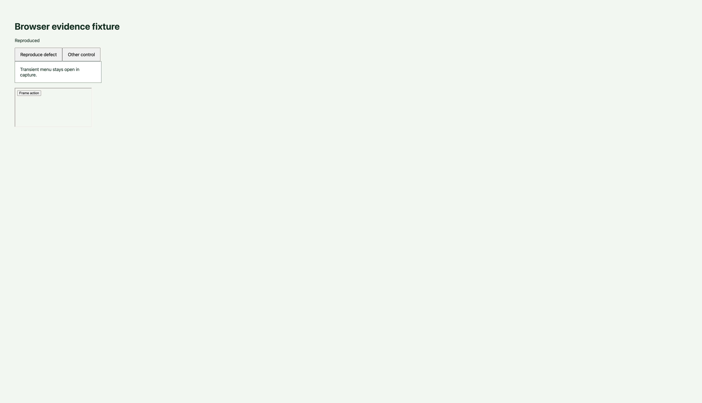

# Lens fixture /a

## Observed

The fixture reports a failed save while its transient menu remains open.

## Expected

The save should complete and the updated image should appear immediately.

Local verification report — no external filing.

- Capture gap (history): Evidence starts when this tab is armed; earlier requests are unavailable
- Capture gap (indexedDB): Database names and versions only; records are not read without a project adapter
- Capture gap (cacheStorage): Cache names only; cache bodies and keys are not enumerated
- Capture gap (cookies): Cookie values intentionally excluded; cookie state is not extracted
- Capture gap (frames): Restricted or ungranted frames are not readable; listed frame URLs do not prove frame contents were captured
- Capture gap (source-build): Diagnostic adapter identifies an unsealed working tree; commit label is not exact deployed source proof

- Capture gap (history): Evidence starts when this tab is armed; earlier requests are unavailable
- Capture gap (indexedDB): Database names and versions only; records are not read without a project adapter
- Capture gap (cacheStorage): Cache names only; cache bodies and keys are not enumerated
- Capture gap (cookies): Cookie values intentionally excluded; cookie state is not extracted
- Capture gap (frames): Restricted or ungranted frames are not readable; listed frame URLs do not prove frame contents were captured
- Capture gap (source-build): Diagnostic adapter identifies an unsealed working tree; commit label is not exact deployed source proof
